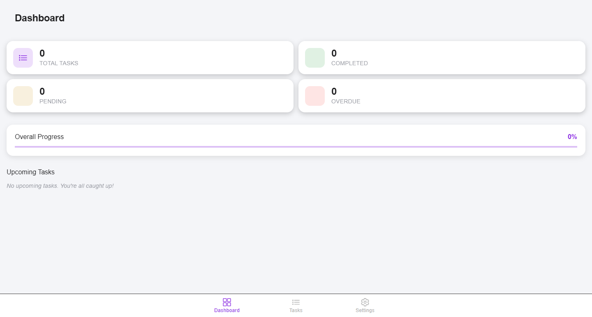
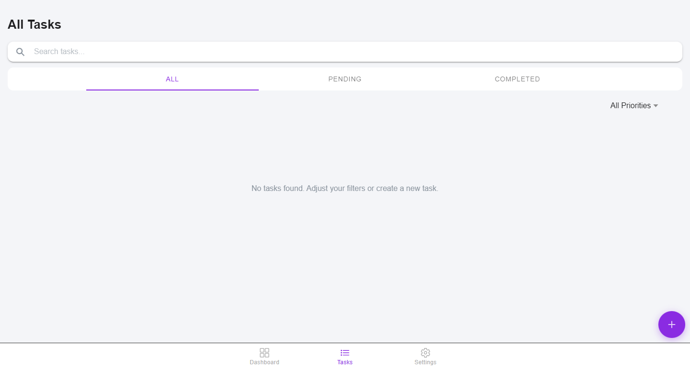
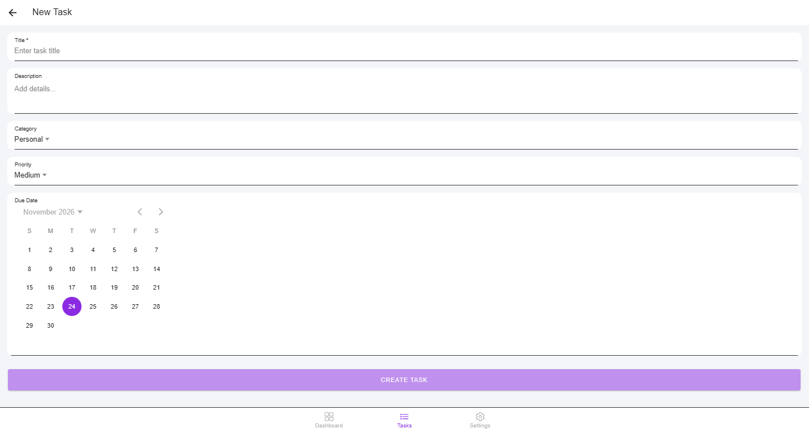

@'
# TaskFlow 📱

TaskFlow is a modern, cross-platform productivity application built with **Ionic, Angular, and Capacitor**. It features a polished, mobile-first design with native dark/light theme support, persistent local storage, and full CRUD functionality for task management.

## ✨ Features

- **Dashboard:** Real-time statistics (Total, Completed, Pending, Overdue) and an overall completion progress bar.
- **Task Management:** Create, read, update, and delete tasks. Mark tasks as complete with a single tap.
- **Search & Filtering:** Search by title, filter by status (Pending/Completed), and filter by priority (Low/Medium/High).
- **Categorization:** Organize tasks into categories (Personal, Work, Study, Development, Other).
- **Theming:** Electric Violet + Dark Navy design with a toggle for Light Mode.
- **Data Persistence:** Tasks are saved locally using `@capacitor/preferences` and survive app restarts.

## 🛠️ Technologies Used

- **Framework:** [Angular 22](https://angular.dev/) (Standalone Components, Signals, Reactive Forms)
- **Mobile UI:** [Ionic 9](https://ionicframework.com/) (`@ionic/angular`)
- **Native Runtime:** [Capacitor 8](https://capacitorjs.com/) (Preferences, Status Bar, Keyboard)
- **Language:** TypeScript (Strict mode)
- **Styling:** SCSS / Ionic CSS Variables

## 🚀 Getting Started

### Prerequisites

- Node.js (v22 or v24 LTS)
- npm (v10+)
- Ionic CLI (`npm install -g @ionic/cli`)

### Installation

1. Clone the repository:

   ```bash
   git clone https://github.com/YOUR_GITHUB_USERNAME/TaskFlow.git
   cd TaskFlow
   ```

2. Install dependencies:

   ```bash
   npm install
   ```

3. Run in the browser:

   ```bash
   ionic serve
   ```

### Running on Android (Native)

1. Build the web assets:

   ```bash
   ionic build
   ```

2. Sync with Capacitor:

   ```bash
   npx cap sync
   ```

3. Open Android Studio:

   ```bash
   npx cap open android
   ```

4. Click the **Run (▶)** button in Android Studio to deploy to an emulator or physical device.

## 📂 Project Structure

```text
src/
├── app/
│   ├── core/           # Singleton services (TaskService, SettingsService)
│   ├── shared/         # Reusable UI components (PageHeader, StatCard, Tabs)
│   ├── features/       # Feature areas (Dashboard, Tasks, Settings)
│   ├── models/         # TypeScript interfaces (Task, CreateTaskPayload)
│   ├── app.component.ts
│   └── app.routes.ts
├── theme/              # Global SCSS variables (Dark/Light theme)
└── global.scss
```

## 📸 Screenshots

| Dashboard (Dark) | Tasks List (Light) | Create Task |
|:---:|:---:|:---:|
|  |  |  |

## 📝 Development Notes

- Built using Angular Standalone Components (no `NgModules`).
- Uses Angular Signals for reactive state management.
- Theming is handled via native CSS variables (`--ion-background-color`, etc.) and a dynamic class toggle on the `<body>` tag.
- Local storage is abstracted behind the `TaskService` using Capacitor's native Preferences API, making it ready to be swapped for a REST API in the future.

---

*Built as a professional portfolio project for Web & Mobile Application Development.*
'@ | Set-Content -Path README.md -Encoding utf8; New-Item -ItemType Directory -Force -Path screenshots | Out-Null; git add README.md screenshots; git commit -m "docs: add professional TaskFlow README"; git branch -M main; if (git remote get-url origin 2>$null) { git remote set-url origin "https://github.com/YOUR_GITHUB_USERNAME/TaskFlow.git" } else { git remote add origin "https://github.com/YOUR_GITHUB_USERNAME/TaskFlow.git" }; git push -u origin main
